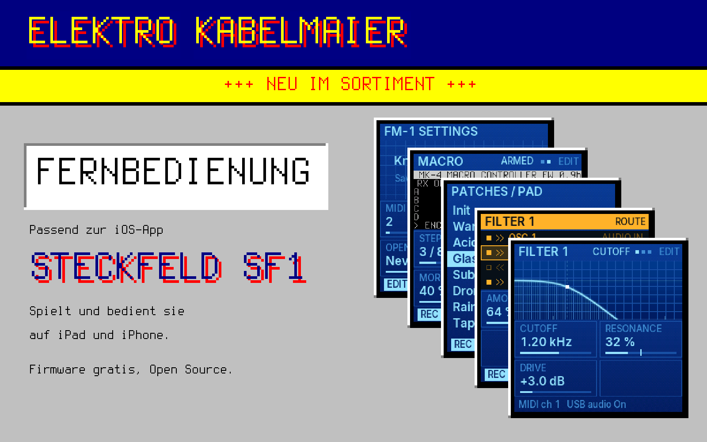

<h1 align="center">Fernbedienung</h1>

  The M-VAVE FM-1 as hardware controller for Steckfeld SF1 on iPad and iPhone 
  <a href="https://thefirmwarehub.com/">Install (FM-1 Firmware Hub)</a> ·
  <a href="https://apps.apple.com/app/steckfeld-sf1/id6830018147">Steckfeld SF1 on the App Store</a> ·
  <a href="CHANGELOG.md">Changelog</a> ·
  <a href="BUILDING.md">Building</a>

## Install

Install from the [FM-1 Firmware Hub](https://thefirmwarehub.com/): pick Fernbedienung, plug in the FM-1, follow the
steps. It installs over M-VAVE's official firmware and over other community firmware, and you can go back to the
official firmware from there too.

While an update is written, the FM-1 shows the update screen of Elektro Kabelmaier, the electronics shop inside
Steckfeld SF1. Don't unplug it until it restarts.

## What it is

Fernbedienung turns the FM-1 into the hardware controller for [Steckfeld SF1](https://steckfeld.app), a modular synth app
for iPad and iPhone ([App Store](https://apps.apple.com/app/steckfeld-sf1/id6830018147)). The FM-1 plugs into the iPad or iPhone over USB-C: its keys play
Steckfeld, its knobs and buttons edit it, its screen shows the selected module, and it is Steckfeld's audio output.
Each Fernbedienung version goes with one Steckfeld version; the [changelog](CHANGELOG.md) says which. More on
[steckfeld.app/fm1-firmware/fernbedienung](https://steckfeld.app/fm1-firmware/fernbedienung).

**What it does** (tested on an FM-1 with an iPad and Steckfeld SF1 1.4.0):

- **Audio:** the iPad's stereo out plays on the FM-1, MASTER sets the volume.
- **Keys:** notes, OCT−/+ for octaves, on the FM-1's MIDI channel with its velocity.
- **Knobs:** KNOB1-4 send CC 20-23, SELECT CC 24 (pages), ALGORITHM CC 25, PRESETS CC 26 (the patch list), all
  relative (1 = one step up, 127 = one step down, as the OP-1 sends them).
- **Buttons:** REC and SAVE send CC 27 and 28 (127 pressed, 0 released). HOME, SCL, FX, LFO, ENV, SEQ, ARP and GLO
  send CC 40-47 when tapped; held while SELECT turns, they send CC 50-57 instead. PLAY sends MIDI start and stop.
- **EDIT:** the FM-1's own settings: MIDI channel, velocity and OPEN (Always: Steckfeld opens its programmer on a
  module picked on the FM-1; Never: it stays closed while the FM-1 is connected). KNOB1-4 change them; EDIT again
  stores them on the FM-1 and tells Steckfeld. The theme (follow Steckfeld, light or dark) is in the system settings:
  hold HOME, press EDIT.
- **Display:** Steckfeld sends the selected module over SysEx: its name and pages, the four knobs' names, values and
  positions, a picture of the module, the cables on the Route screen and the patch list. In Steckfeld's display
  colours: blue by day, red in the dark. Until Steckfeld answers, the FM-1 says it is waiting and the controls still
  work.

The protocol is in [docs/fernbedienung/protocol.md](docs/fernbedienung/protocol.md) (CC0: any app may implement
it).

> [!WARNING]
> **Installing custom firmware is at your own risk.** Fernbedienung is unofficial firmware, provided as is, without any
> warranty (GPL-3.0 sections 15 and 16). It is not made, endorsed or supported by M-VAVE or teenage engineering. A
> failed or interrupted install can leave the FM-1 unable to start until it is recovered with a USB tool. You can
> return to the official firmware at any time.

## Build

See **[BUILDING.md](BUILDING.md)**: the toolchain, `./build.sh`, the host simulator and tests, the emulator, and how
a release is made. [docs/DEVELOPING.md](docs/DEVELOPING.md) describes the platform and its app API.

## Credits

Fernbedienung is a fork of [Beiwagen](https://github.com/DPangerl/beiwagen), itself a fork of
[FM1_AudioBase](https://github.com/stevexfer/FM1_AudioBase) by stevexfer, itself a fork of
MOOD_FM1, the FM-1 port of MOOD, which was built on [GATOR](https://github.com/npi3pak/fm1-gator) by npi3pak. It
stands on the work of:

- **stevexfer**: [FM1_AudioBase](https://github.com/stevexfer/FM1_AudioBase), the duplex USB audio base and its
  visualizer.

- **Leo Kuroshita, Hügelton Instruments**: [Felucca](https://github.com/hugelton/Felucca), the FM-1 platform: HAL,
  update loader, USB-MIDI, USB audio, OTA, storage and installers (GPL-3.0).
- **npi3pak**: [GATOR](https://github.com/npi3pak/fm1-gator), the platform cut down and its release tooling.
- **dspaudio**: [ORBIT](https://github.com/dspaudio/orbit), the platform GATOR was cut down from.
- **isod89**: [SLOOP](https://github.com/isod89/sloop-fm1), the web install protocol and the stock supply levels.
- **Quixotic7**: [ChoralRoot](https://github.com/Quixotic7/ChoralRootFM1), the audio interrupt fix and the release
  layout; [MvaveFM1Unbricker](https://github.com/Quixotic7/MvaveFM1Unbricker).
- **Charles Vestal**: [AMB-1](https://github.com/charlesvestal/fm1-amb), which showed the FPU in use on the FM-1.
- **Rasmus Andersson and the Inter Project Authors**: the Inter font (SIL OFL 1.1).
- **Dimitar Toshkov Zhekov**: the Terminus font (SIL OFL 1.1).
- **JieLi Technology**: three AC79 SDK files in every package (Apache-2.0).

## License

Fernbedienung is free software under the [GNU General Public License v3.0 only](LICENSE), provided without any
warranty. The parts it is built from keep their licences and copyright notices:

| Part | Author | Licence | Text |
|---|---|---|---|
| Beiwagen (USB playback changes, the page kit `bw_ui.h`, the keys `bw_keys.h`) | Daniel Pangerl | GPL-3.0-only | [LICENSE](LICENSE) |
| Fernbedienung (the fernbedienung app, system settings, the loader's update screen) | Daniel Pangerl | GPL-3.0-only | [LICENSE](LICENSE) |
| Fernbedienung protocol (`docs/fernbedienung/`) | Daniel Pangerl | CC0-1.0 | [protocol.md](docs/fernbedienung/protocol.md) |
| FM1_AudioBase, MOOD_FM1's visualizer, GATOR (the app, web installer, release tooling) | stevexfer; npi3pak | GPL-3.0-only | [LICENSE](LICENSE) |
| Felucca platform: HAL, update loader, USB-MIDI, USB audio, OTA, storage, tools (through ORBIT and SLOOP, modified) | Leo Kuroshita, Hügelton Instruments | GPL-3.0-only | [LICENSE](LICENSE) |
| Web install protocol `fm1ota.js`, `fm1pkg.js` (from SLOOP 2.7; `fm1ota.js` finds the loader's macOS port names too) | Leo Kuroshita, Hügelton Instruments; isod89 | GPL-3.0-only | [LICENSE](LICENSE) |
| Inter font (rasterised into the firmware) | The Inter Project Authors | SIL OFL 1.1 | [LICENSES/OFL-Inter.txt](LICENSES/OFL-Inter.txt) |
| Terminus font (rasterised into the firmware) | Dimitar Toshkov Zhekov | SIL OFL 1.1 | [LICENSES/OFL-Terminus.txt](LICENSES/OFL-Terminus.txt) |
| Three AC79 SDK files in every package (`tools/sdk`, unmodified) | JieLi Technology | Apache-2.0 | [LICENSES/Apache-2.0-JieLi-SDK.txt](LICENSES/Apache-2.0-JieLi-SDK.txt) |

Every release and the web installer carry these licence texts next to the packages, and each release's complete
source is its tag in this repository. [LICENSING.md](LICENSING.md) has the details.

"M-VAVE" and "FM-1" are trademarks of their respective owners; "teenage engineering" and "OP-1" are trademarks of
teenage engineering. Fernbedienung is not affiliated with, endorsed by or supported by them.
